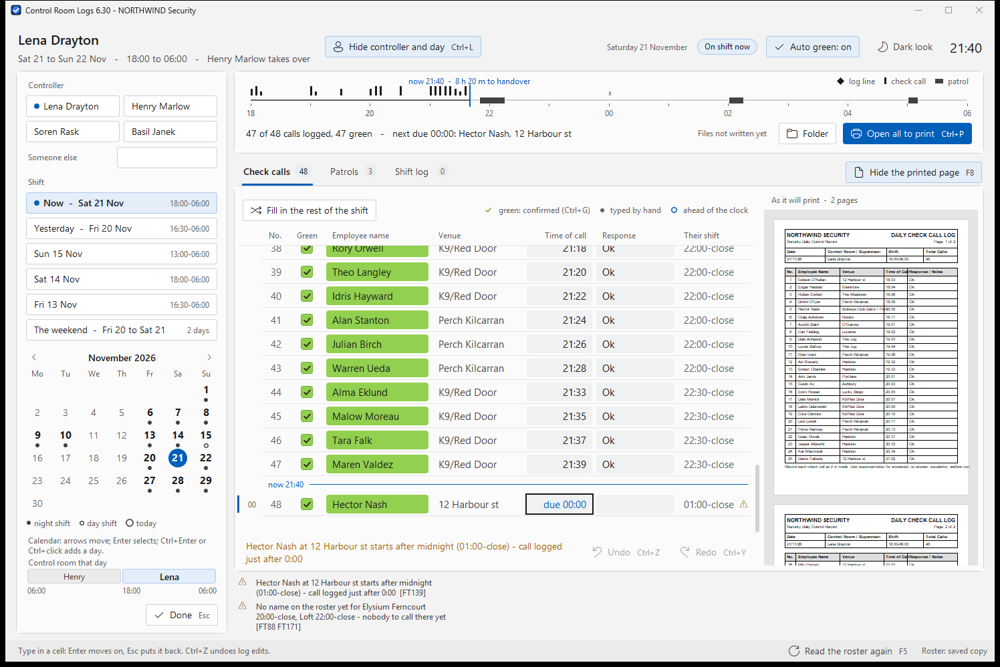
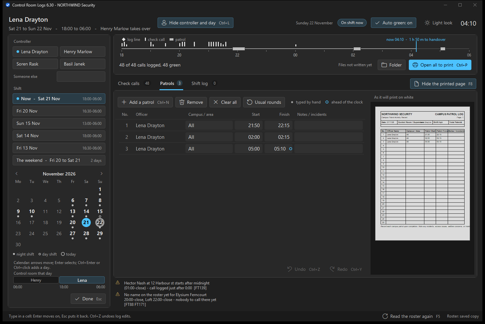
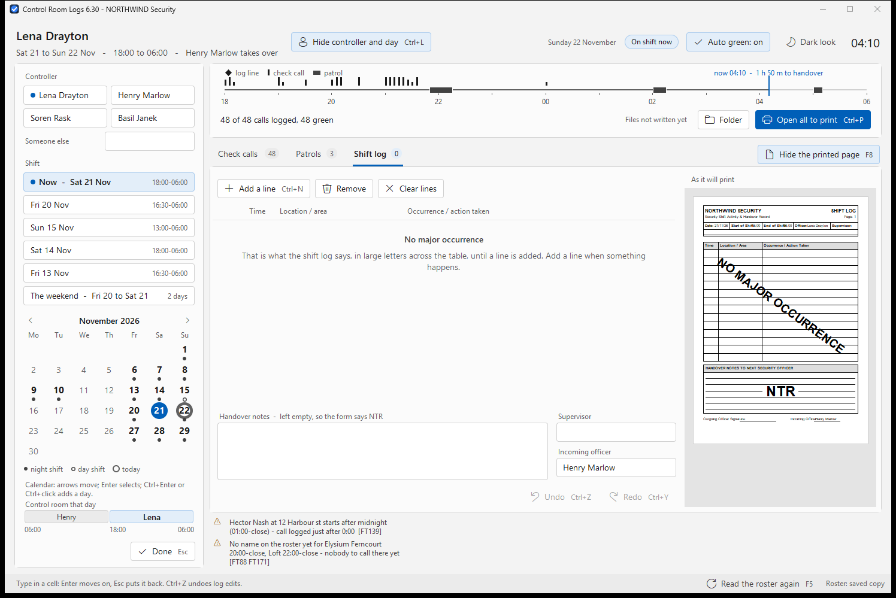

# Check Call Log - Control Room Check Calls, Patrol Logs and Shift Logs

In a security control room, every guard gets a "check call" about an hour before their shift, to make sure
they're on their way. The controller writes every call on a paper log, along with patrols and anything that
happens during the night. Doing it by hand from the roster takes ages and is easy to get wrong.

**Check Call Log does the paperwork for you.** Pick the controller and the night, and it reads the staff
roster and builds the full list of who to call and when, in order. Tick each one off as you call. It also fills in
the patrol log and the shift log, and prints all three forms together, laid out exactly like the paper ones
in the binder.

**[Try it live in your browser](https://assembler-fourier.github.io/check-call-log/live/)** - the real Python code
running on a made-up roster (through Pyodide): pick a night and a controller, see the calls, download the printed PDF.







*Everything in the screenshots is made up. "Northwind Security", the staff and the venues are invented demo data.*

## Why it helps

- **The call list writes itself.** Everyone whose shift starts during yours, with a call time an hour before they start.
- **Tick as you go.** Mark a call answered and the person's name turns green on the roster (optional; it needs a small script on the sheet).
- **Three forms in one click.** Check Call Log, Campus Patrol Log and Shift Log, printed together as one PDF, or saved as Excel.
- **See your whole night at a glance.** A timeline of calls, patrols and log lines from the start of the shift to handover.
- **Spots problems for you.** Names on the roster with no time, a venue with nobody on it, a shift starting after midnight.
- **Easy to fix.** Change any time or answer by hand, with full undo and redo. Your changes are kept for that night.
- **Hands over by itself.** Fifteen minutes before the next controller's shift the window writes the outgoing logs and
  moves to the new shift - no reminder to dismiss. Click any controller's name and it opens their shift on now, else
  today's, else their next one.
- **Auto green.** Per controller: as calls are answered, the names turn green on the roster by themselves. With it off,
  a name you turn green by hand gets that minute as its time of call.
- **Fill in the rest of the shift** when the sheet is wanted complete before the shift ends; correct what differs later.
- **WhatsApp reader (optional).** A Chrome add-on reads the guards' replies from WhatsApp Web on the same PC and fills
  in who answered: "Yes", "All good", a thumbs-up on the question, or "sick tonight" left blank for you to read, with
  the guard's own reply time as the time of call. It can prepare the check-call messages as drafts and send one
  reviewed message at a time. Switch Auto read off and the log is plain again. See [WhatsApp reader](#whatsapp-reader).
- **Light and dark mode**, keyboard shortcuts, and a live preview of the printed page.

## Try it in 1 minute

You need Windows and Python 3.11 or newer. Nothing else needs installing.

```bash
git clone https://github.com/Assembler-Fourier/check-call-log.git
cd check-call-log
python tool/app.pyw
```

It opens in **demo mode** with a made-up roster that always includes the current week.

From the command line:

```bash
python tool/calllog.py sat                    # tonight's log for the default controller
python tool/calllog.py sat --name henry       # another controller (a first name is enough)
python tool/calllog.py fri sat sun --patrols --shift-log
python tool/calllog.py 31/10 --dry            # just print the list, write nothing
```

The PDFs and spreadsheets go to `Logs/`.

## Use it with your own roster

1. Share the roster Google Sheet as *anyone with the link can view*.
2. Set its id with `setx ROSTER_SHEET_ID "your-sheet-id"`, or put `{ "roster_id": "your-sheet-id" }` in `tool/config.json`.
3. Change the controller names, the control-room label and your company name at the top of `tool/calllog.py` and `tool/forms.py`.
4. Double-click `Make Call Log.bat`.

Optional *green ticks on the roster*: the window can paste in a small Google Apps Script for you to deploy
on the sheet. It only lets today's names turn green or white, and nothing else.

## WhatsApp reader

Optional, for a controller who sends the check calls as WhatsApp messages from the control-room phone's WhatsApp Web.

1. In Chrome open `chrome://extensions`, switch on *Developer mode*, press *Load unpacked* and choose the `reader`
   folder. Refresh the WhatsApp Web tab.
2. Set who uses it in `tool/whatsapp.json` (`"controllers"`, the trusted senior staff, the phone numbers), or keep the
   demo defaults. `python tool/whatsapp.py setup` writes the add-on's local key.
3. Open Check Call Log: the line under the table says *WhatsApp connected*. **Auto read** watches the chats,
   **Full check** visits each rostered guard's chat once, **Messages & drafts** prepares the questions.

Everything stays on the PC: the add-on talks only to the window on `127.0.0.1`, signed with a shared key. Reading never
types or sends; *Sending* starts off every time, and a message goes only when you press *Send to <name>* after
reviewing it. Full details are in [`reader/HOW TO INSTALL.txt`](reader/HOW%20TO%20INSTALL.txt).

## Who it is for

Security companies and their control rooms, guarding and door-staff firms, facilities and event-staffing
teams: anyone who phones staff before their shifts and keeps paper patrol and shift logs.

**Keywords:** check call log, security control room software, guard check calls, patrol log, shift log,
daily occurrence book, security guard roster, Google Sheets roster, printable PDF forms, workforce
management, Python desktop app, tkinter, Windows.

---

## Technical details

**Stack:** Python 3 standard library only (tkinter, `urllib`, `zipfile`, `xml.etree`), no third-party
packages. PDF and XLSX files are written directly, byte by byte. There's an optional Google Apps Script
web app for the write-back, and an optional Chrome (Manifest V3) add-on in plain JavaScript for WhatsApp Web.
The [live demo](https://assembler-fourier.github.io/check-call-log/live/) runs the same `calllog.py` in the browser
with Pyodide and draws the PDF with PDF.js (`live/`).

**WhatsApp reader.** `reader/` reads the open conversation and the chat list from WhatsApp Web's page and posts
signed (HMAC) reports to a small receiver inside the window on `127.0.0.1:8765`. `whatsapp.py` turns them into
evidence per call: a dated question for the guard's own venue, then a verified reply (`judge()` classifies *yes*,
*no*, *unclear*, with offers for another day, late arrivals and taken-back answers kept apart). Only a verified
reply, a reply you typed, or the trusted-person rule can turn a name green; a voice note, photo or unclear message
is shown for you to read. `wa_read.py` paces the reading passes, `wa_bridge.py` queues draft and send actions with
capability checks, `wa_contacts.py` matches the phone's contact names to the roster.

**Roster parsing.** `xl.py` reads the `.xlsx` export (shared strings, styles, fills, strike-through, merges
and comment anchors). `calllog.py` finds the controller's own shift on the control-room row, then lists
everyone whose check-call mark (start minus `LEAD`) falls inside it, across midnight and into the next
morning's early starts. Shift strings are parsed with tolerant regexes (`20:00-close`, `21:00-03-00`,
`20-00 - close`). Notes, placeholders (`spare`, `A/L`, `cover needed`) and labels typed into the grid are
classified by first word and by whole cell, so a real person is never dropped.

**Call scheduling.** Calls are grouped by mark, with the first offset and the gaps in between seeded per
controller so times look natural and stay stable. Patrol rounds are generated per controller and per day
with a personal "habit" bias inside fixed windows, then stored as id-keyed overlays
(`changed / removed / added`), so hand edits never hide rounds still to come.

**Forms engine.** `forms.py` draws each form once against an abstract page (`line`, `box`, `text` in
millimetres). `PdfPage` emits PDF and `CanvasPage` renders the same drawing on a Tk canvas, so the preview
and the printout can't drift. Long occurrences wrap and paginate, and an "All Logs" PDF merges every form for the shift.

**Live roster watch.** Every 30 s it fetches a CSV range of just the shift's columns (~5 KB). On a
change, it re-reads the whole workbook and reports what changed (added, removed, times, colours), with
backoff when Google throttles requests.

**Guarded write-back.** `rostercolour.py` posts one HTTPS request per click to an Apps Script web app,
authenticated by a shared key. The script enforces the same rules as the client: Europe/Dublin "today"
(with a before-noon grace period for the night before), green or white only, an expected current colour, the exact name
match, no merged cells, header rows, times or notes, and an execution log. `t_script.py` runs the real
script under `cscript` against a simulated Google Sheets API (time zones, DST, R1C1, merges).
`t_mutate.py` applies about 57 deliberate mutations to the script and requires the test suite to catch every one.

**Tests.** 36 suites, about 3,000 checks, run with `tool/tests/run_all.ps1`, plus three Node suites for the
add-on (`t_reader.js`, `t_drafts.js`, `t_read_worker.js`, about 1,850 checks). The window suites drive the
real Tk app off-screen, with a frozen clock (`CCL_NOW`) and scratch output folders. The fixture
`roster-2026-10-19.xlsx` is an anonymised snapshot in the real layout.

| Suite | Covers |
|---|---|
| `t10`, `t_notes` | roster reading, notes vs people, flags shown to the controller |
| `t_script`, `t_mutate` | Apps Script rules under `cscript`, mutation testing |
| `t_link`, `t_green`, `t_auto` | write-back link, Green box, Auto green and the roster watcher |
| `t_ux`, `cases6`, `smoke6` | window behaviour, undo/redo, forms, theme |
| `cases` | the legacy v5 window |
| `t_whatsapp*`, `t_wa_*` | reply judging, reading passes, drafts and sending, contacts, the receiver, the window's WhatsApp controls |
| `t_only_lena`, `t_access`, `t_layout`, `t_mainloop` | WhatsApp only on its controller's log, keyboard access, layout at the minimum size, the real event loop |

**Layout**

```
Make Call Log.bat / Previous version.bat   launchers (current window / legacy v5)
tool/
  app.pyw        tkinter window (v6)          app5.pyw   legacy window (v5)
  calllog.py     roster -> calls, patrols, shift log; CLI
  forms.py       PDF + XLSX writers, form drawings
  grid.py widgets.py skin.py   custom table, controls, light/dark theming
  rostercolour.py              optional Apps Script write-back
  whatsapp.py    WhatsApp evidence, reply judging, the local receiver
  wa_ui.py wa_read.py wa_bridge.py wa_contacts.py wa_beta.py   reader controls, reading passes, drafts, contacts
  xl.py          minimal read-only xlsx reader
  tests/         36 suites + fixtures
reader/          Chrome add-on for WhatsApp Web (manifest, reader.js, worker.js, drafts.js)
live/            the browser demo (index.html + demo.py, served by GitHub Pages)
demo/
  roster-template.xlsx  anonymised roster in the real layout
  make_demo.py          moves its dates to the current week
docs/screenshots/
```

Sister project: [sheet-tracker](https://github.com/Assembler-Fourier/sheet-tracker), which reads the same roster for weekly timesheets.

## Licence

MIT. See [LICENSE](LICENSE).
